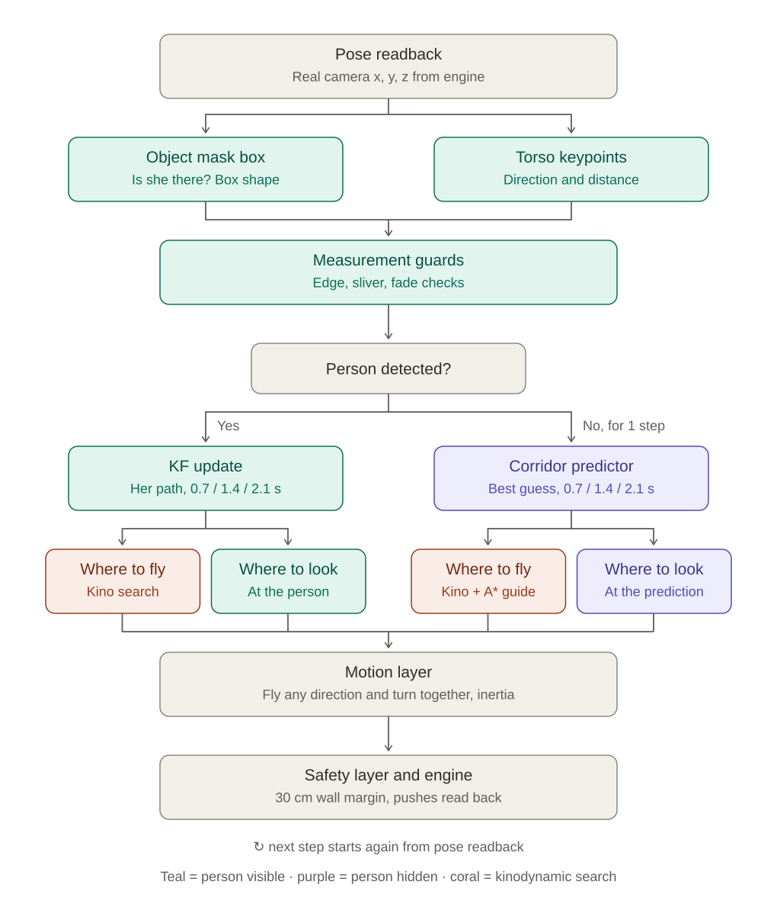

# Aero2711 — UAV tracking of a walking person through a maze under occlusion

**中文**：在迷宫中用无人机跟踪一个行走的人，人会被墙挡住、会拐进侧向走廊。仿真平台为 UnrealZoo（Unreal Engine 5 + UnrealCV）。

**English**: a camera drone follows a walking person through a maze where walls hide her and she turns into side corridors. Simulated in UnrealZoo (Unreal Engine 5 + UnrealCV).



---

## Pipeline / 系统流程

| Stage / 模块 | English | 中文 |
|---|---|---|
| Pose readback | real camera position read back from the engine every step | 每一步从引擎读回相机的真实位置 |
| Object mask box | is she visible; box shape | 是否看得见；检测框形状 |
| Torso keypoints | direction from the neck/chest/pelvis column, distance from the neck–pelvis pixel length | 由颈、胸、骨盆的平均列得方向，由颈到骨盆的像素长度得距离 |
| Measurement guards | edge / sliver / fade checks for partly hidden boxes | 检测框被画面边缘或墙切掉时的检查 |
| KF | smoothed position and velocity while she is visible | 看得见时平滑她的位置和速度 |
| Corridor predictor | while hidden: several guesses move along the corridors, split at junctions, are ruled out when seen empty | 看不见时：多个猜测沿走廊前进，路口分叉，看过没人就排除 |
| Kinodynamic look-ahead search | from the drone's current velocity, try 9 accelerations × 6 steps of 0.35 s; choose the path that keeps her predicted positions at 0.7 / 1.4 / 2.1 s in view | 从无人机当前速度出发，试 9 种加速 × 6 步（每步 0.35 s），选能在 0.7 / 1.4 / 2.1 s 看见她预测位置的路线 |
| A\* guide (hidden only) | long-range direction toward a spot that can see the best guess | 看不见时的远距离引导：朝能看见最可信猜测的位置飞 |
| Motion layer | fly in any direction and turn at the same time; turning inertia (τ = 0.3 s) | 可以任意方向飞、同时转向；转向惯性（τ = 0.3 s） |
| Safety layer | ≥ 30 cm from walls, ≤ 1.5 m/s, ≤ 2 m/s² | 离墙 ≥ 30 cm，速度 ≤ 1.5 m/s，加速度 ≤ 2 m/s² |

## Results / 结果

Random-walk target that walks from the maze entrance to the exit, real-time simulation, maze `fr10x10l35t24g_s0`.
人物随机行走（带惯性的随机加减速）从迷宫入口走到出口，实时仿真。

| Version / 版本 | Episodes / 局数 | Reached the exit / 跟到终点 | Time out of view / 看不见的时间 |
|---|---|---|---|
| Before the drone-body fix (2026-10-12) / 修复无人机机身问题之前 | 20 (seeds 0–9 × 2) | 12/20 | 21% |
| + predictor fixes, turning inertia / 预测器修复 + 转向惯性 | 5 (seeds 0,3,4,5,7) | 4/5 | 20% |
| + A\* look-ahead planner / A\* 前瞻规划器 | 5 (seeds 0,3,4,5,7) | 5/5 | 9% |
| + kinodynamic search (visible) / 运动学搜索（看得见时） | 10 (seeds 0–9) | 10/10 | 0.9% |
| + kinodynamic search also while hidden, A\* guide / 看不见时也用运动学搜索 + A\* 引导 | 10 (seeds 0–9) | 10/10 | 1.4% |

**Caveats / 说明**: small samples (5–10 episodes, real-time runs vary between runs); torso keypoints are simulated from engine bones with 2 px noise; the turning time constant is borrowed from a system-identification study of another drone, not measured on our Tello/RMTT. 样本小（5–10 局，实时运行每次不同）；关节点由引擎骨骼加 2 px 噪声模拟；转向时间常数借用其他无人机的辨识结果，尚未在我们的 Tello/RMTT 上实测。

## Repository layout / 目录

| Folder / 目录 | Content / 内容 |
|---|---|
| `experiments/` | all code (see below) / 全部代码 |
| `results/metrics/` | one JSON line per episode for every batch run / 每次批量实验的逐局结果 |
| `results/figures/` | figures, including the pipeline diagram / 图，包括 pipeline 图 |
| `env_config/` | environment configuration and calibration data / 环境配置和标定数据 |
| `docs/` | progress report and its sources / 进度报告及其源文件 |

Not in this repository: videos, raw logs, per-step `.npy` logs, the UnrealZoo binary (~72 GB), third-party projects. 不在仓库里：视频、原始日志、逐步 `.npy` 数据、UnrealZoo 程序（约 72 GB）、第三方项目。

### Main files in `experiments/` / 主要代码

| File | English | 中文 |
|---|---|---|
| `uz_env.py` | UnrealZoo/UnrealCV wrapper: spawn, camera, mask detection | UnrealZoo/UnrealCV 封装：生成人物、相机、掩码检测 |
| `uz_run.py` | closed-loop episode: measurement, KF, predictor, planners, motion; all switches at the top of the file | 闭环一局：测量、KF、预测器、规划器、运动；所有开关在文件开头 |
| `uz_maze.py` | maze geometry, target walking model, corridor predictor | 迷宫几何、人物行走模型、走廊预测器 |
| `uz_astar.py` | A\* viewing-spot planner on a 20 cm grid | 20 cm 网格上的 A\* 观察点规划器 |
| `occl_core.py` | camera model, KF, controller, safety layer | 相机模型、KF、控制器、安全层 |
| `uz_sweep.py` | batch presets (e.g. `rwkino`, `rwkinob`), per-step logs | 批量实验配置和逐步日志 |
| `uz_video_maze.py` | run one episode and record first-person + top-view videos | 跑一局并录制第一视角和俯视视频 |
| `uz_replay_steplog.py` | rebuild a video from a batch run's per-step log (skeleton, KF box, planner overlays) | 从批量运行的逐步日志重建视频（骨架、KF 框、规划叠加） |
| `run_sweep_watchdog.sh`, `wait_then_run.sh` | restart a stalled batch run; wait until no other engine job is running | 批量运行卡住时自动重启；等其他引擎任务结束再运行 |

Older scripts for the earlier L-shaped corridor stage (`run_metrics_test.py`, `run_*_margin30.py`, …) are kept for reference. 早期 L 形走廊阶段的脚本保留作参考。

## How to run / 运行方法

Requirements / 环境: Windows, conda env `unrealzoo` (Python + `unrealcv`), UnrealZoo UE5.7 binary (path set in `uz_env.py`).

```bash
# 10 episodes, full system (kinodynamic search in both phases) / 完整系统 10 局
bash experiments/run_sweep_watchdog.sh 10 rwkinob

# one recorded episode, seed 5 / 录制一局
python experiments/uz_video_maze.py fr10x10l35t24g_s0 ca 5 rw --edgemeas --edgeaim --blindspeed --mapclamp --egocomp --worldpred --corridor --cleanvel --astar --T=1 --L=30 --anim --stop --ib --ff --kppos --kprange --rex --cf --rch --yi --et --kino --kinob --steps=2000

# rebuild a video from a batch log, with planner overlays / 从批量日志重建视频并叠加规划信息
python experiments/uz_replay_steplog.py rwkinob_fix_yi_et_kino_kinob_s5 1 903 300 overlay
```

Only one project should run the UnrealZoo engine at a time: the cleanup step closes every UnrealZoo engine. 同一时间只运行一个使用 UnrealZoo 引擎的项目：清理步骤会关闭所有 UnrealZoo 引擎。

### Main switches (`uz_run.py`) / 主要开关

| Switch | English | 中文 |
|---|---|---|
| `KP_POS`, `KP_RANGE` | torso keypoints for direction and distance | 用躯干关节点测方向和距离 |
| `SLIVER_GUARD`, `BODY_FIX` | ignore box size for slivers; read back the real camera pose | 细条框不用来测距；读回相机真实位置 |
| `CORR_CAME_FROM`, `CORR_REACH` | "backward" = the cell she came from; restart over the reachable cells | "往回"指她来的格子；从可达格子重新撒猜测 |
| `YAW_INERTIA` | turning inertia, τ = `YAW_DYN_TAU` | 转向惯性 |
| `ET_PLANNER`, `ET_KINO` | look-ahead planning while visible; kinodynamic version | 看得见时的前瞻规划；运动学版本 |
| `KINO_BLIND`, `KINO_GUIDE_W` | kinodynamic search while hidden; weight of the A\* guide | 看不见时的运动学搜索；A\* 引导权重 |
| `KP_FIRST` | valid keypoints win over the box guards (off by default) | 关节点有效时优先于检测框检查（默认关闭） |

## Related work / 参考

This project adapts, in simplified form, ideas from / 本项目以简化形式借鉴了：
- Fast-Planner (Zhou et al., 2019) — kinodynamic search from the current state / 从当前状态出发的运动学搜索
- Fast-Tracker (Han et al., 2021) and Fast-Tracker 2.0 (Pan et al., 2021) — target tracking with kinodynamic search; human location from the neck–hip pixel length / 用运动学搜索跟踪目标；用颈到髋的像素长度估计人的位置
- Elastic Tracker (Ji et al., ICRA 2022) — keep the target visible at future moments, yaw planned separately / 在未来时刻保持目标可见，偏航单独规划
- Intention-Aware Planner (2023) — turning intention from body orientation / 用身体朝向判断转弯意图
- UnrealZoo (2024) — simulation environments / 仿真环境

Our part is combining these with a corridor-constrained predictor for mazes and testing it in this scenario. 我们的工作是把这些方法与迷宫走廊约束的预测器结合，并在这个场景中测试。
