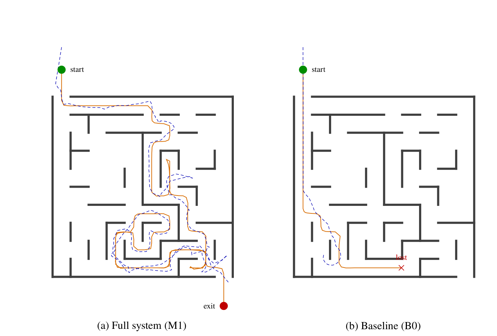
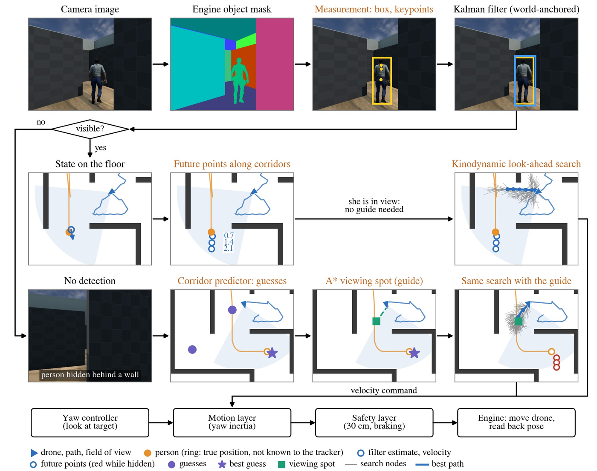
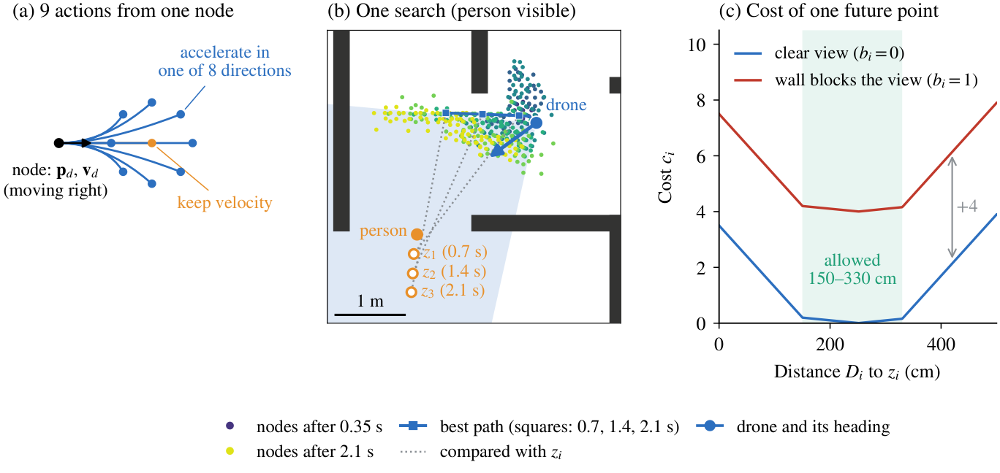
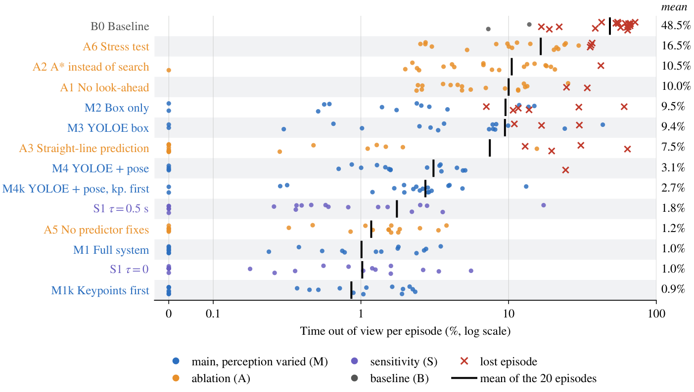
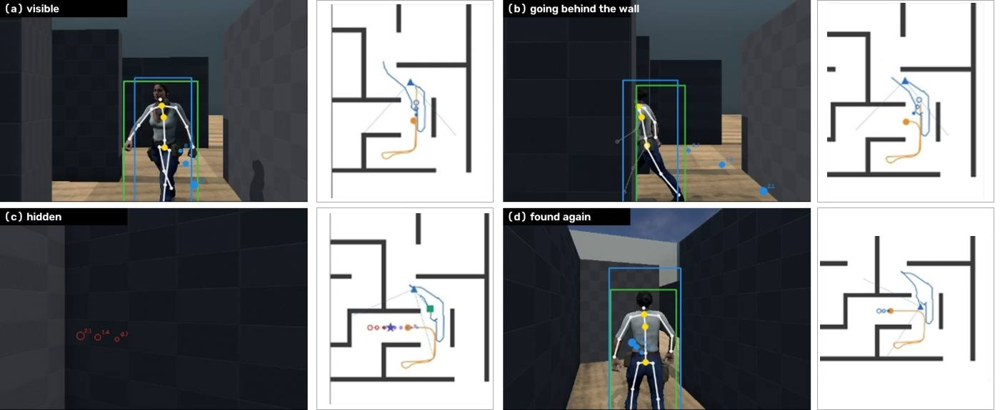

# Aero2711: a drone following a person through a maze

A tracking pipeline for a camera drone that follows a walking person indoors, from detection to velocity commands. Walls often hide the person, and she may turn into a side corridor, slow down or speed up while hidden. The pipeline is tested in a generated maze in [UnrealZoo](https://github.com/UnrealZoo/unrealzoo-gym) (Unreal Engine 5.7, controlled through UnrealCV).

This is a small simulation study for the AERO2711 research project at the University of Sydney. Its starting point is the modular tracker OA-VAT (CVPR 2026).



*One maze, one seed. Orange: the person's walk; blue dashed: the drone's path. Left: the full system (M1) follows her to the exit. Right: the baseline (B0) loses her about 63% of the way along.*

## Pipeline



| Part | What it does |
|---|---|
| Perception | Person box from the engine's object mask (oracle), or from YOLOE + YOLO11s-pose (real) |
| Torso keypoints | Direction from the keypoint column; range from the neck–pelvis pixel length |
| Measurement guards | Handle boxes cut by a wall corner or the image edge (sliver, cut top, fading) |
| World-anchored filter | Kalman filter on the image box, held fixed on the floor while the camera moves; floor velocity from successive floor positions |
| Corridor predictor | While she is hidden: up to 16 weighted guesses move along the corridor centre lines, split at junctions, and lose weight when the camera sees their place empty |
| Kinodynamic look-ahead search | Beam search over the drone's position and velocity (9 actions × 6 layers of 0.35 s, ≤ 2 m/s²), keeping her predicted positions 0.7 / 1.4 / 2.1 s ahead in view at 1.5–3.3 m |
| A\* guide | While she is hidden: guides the search toward a spot that can see the best guess |
| Heading | Controlled separately (proportional + feed-forward, ≤ 90°/s, first-order lag τ = 0.3 s) |
| Safety layer | Braking-distance limit that keeps the drone ≥ 30 cm from walls; speed ≤ 1.5 m/s |



## Results

One maze layout (`fr10x10l35t24g_s0`, 10 × 10 cells of 2 m). The person walks at random from the entrance to the exit and changes speed every 1–3 s. All runs are in real time: 14 configurations × 20 episodes (seeds 0–9, two repeats each).

| Configuration | Success | Time out of view |
|---|---|---|
| B0 Baseline (box only, no map-based prediction, no planner) | 2/20 | 48.5% |
| M2 Box only (no keypoints) | 14/20 | 9.5% |
| **M1 Full system** (oracle perception) | **20/20** | **1.0%** |
| M3 YOLOE box | 17/20 | 9.4% |
| M4 YOLOE + YOLO11s-pose | 19/20 | 3.1% |
| M4k YOLOE + pose, keypoints first | 20/20 | 2.7% |
| A1 No look-ahead (turn, then fly) | 18/20 | 10.0% |
| A2 A\* instead of the search | 19/20 | 10.5% |
| A3 Straight-line prediction | 16/20 | 7.5% |
| A5 No predictor fixes | 20/20 | 1.2% |
| A6 Stress test (A1 + A\* while hidden) | 17/20 | 16.5% |
| S1 Turning lag τ = 0 / 0.5 s | 20/20 / 20/20 | 1.0% / 1.8% |



What the ablations suggest:

- The look-ahead search mainly prevents occlusions: without it, the person was seen again after a hidden period 7.1 times per episode instead of 1.1.
- The torso keypoints matter about as much as the search, because the box alone gives a much larger position error (median about 32 cm instead of 9 cm).
- The corridor predictor appears to help in finding the person again once she is lost, but at this sample size the effect is not clear.
- The predictor fixes and the turning lag showed no clear effect.

The computation per step is 6.4 ms without the detector and 73.7 ms with it (i9-13900KF, RTX 4090).



### Limitations

- All results come from one maze layout, which was also used to tune the pipeline.
- The wall map is given, and the drone's pose is read from the simulator.
- The drone is a kinematic model (acceleration limit and yaw lag; no attitude dynamics).
- With 20 episodes per configuration, 19/20 and 20/20 cannot be told apart.
- Nothing has been flown on a real drone.

## Repository layout

| Path | Content |
|---|---|
| `experiments/` | Code (see below) |
| `env_config/data/maze_fr10x10l35t24g_s0.json` | The maze layout used in all experiments |
| `results/metrics/uz_sweep_rwfinal.jsonl`, `uz_sweep_rwfinalkpf.jsonl` | One JSON line per episode of the final evaluation |
| `results/final_summary.csv` | Summary table of the 14 configurations |
| `assets/` | Figures used in this README |

### Code

| File | Purpose |
|---|---|
| `uz_run.py` | One closed-loop episode: perception, guards, filter, predictors, planners, heading, motion; the switches are at the top of the file |
| `uz_maze.py` | Maze generation and geometry, the person's random walk, the corridor predictor |
| `uz_astar.py` | A\* viewing spots and the distance field of the A\* guide (20 cm grid) |
| `occl_core.py` | Camera model, Kalman filter, controller, motion and safety layer |
| `uz_env.py` | UnrealZoo / UnrealCV wrapper: engine start, character, camera, object mask |
| `uz_routes.py` | Helpers for navigation points and routes in a scene |
| `perception_server.py` | YOLOE-11l-seg + YOLO11s-pose as a local GPU service |
| `dp_server.py`, `uz_collect_maze.py`, `dp_build_zarr.py` | OA-VAT diffusion planner (tried and dropped): service, training data, dataset |
| `uz_sweep.py` | Batch runs; presets `rwfinal` and `rwfinalkpf` give the final evaluation |
| `run_sweep_watchdog.sh`, `supervise.sh`, `kill_sweep.ps1` | Restart a stalled batch run |
| `summarize_final.py` | Rebuild the result table from the episode logs |
| `analyze_reacq_ev.py`, `uz_analyze_episode.py` | Analysis of re-acquisitions and of single logged episodes |
| `uz_video_maze.py`, `uz_replay_steplog.py`, `make_phone_video.py` | Record an episode, or rebuild a video from a step log |

## How to run

Requirements: Windows, the UnrealZoo UE5.7 binary, and a conda env with `unrealcv`, `numpy`, `scipy` and `opencv`. The engine path is set in `uz_env.py`. Real perception (M3, M4, M4k) needs a second env with `ultralytics` and the YOLOE / YOLO11s-pose weights, with the service started first:

```bash
# in the env with ultralytics, from the folder that holds the weights
python experiments/perception_server.py 6020 0.3 pose
```

```bash
# final evaluation: 12 configurations x seeds 0-9 (run twice per seed by the preset)
bash experiments/run_sweep_watchdog.sh 10 rwfinal
bash experiments/run_sweep_watchdog.sh 10 rwfinalkpf

# result table
python experiments/summarize_final.py
```

The batch scripts close every running UnrealZoo engine when they clean up, so run one engine job at a time.

## Main references

- OA-VAT: H. Sun et al., "Instance-level visual active tracking with occlusion-aware planning", CVPR 2026
- UnrealZoo: F. Zhong et al., ICCV 2025; UnrealCV: W. Qiu et al., ACM MM 2017
- Fast-Planner (Zhou et al., RA-L 2019), Fast-Tracker (Han et al., ICRA 2021), Fast-Tracker 2.0 (Pan et al., 2021)
- Elastic Tracker (Ji et al., ICRA 2022)
- Road-map assisted tracking (Ulmke and Koch, 2006); negative information (Koch, 2007)
- YOLOE (Wang et al., ICCV 2025); Ultralytics YOLO11
